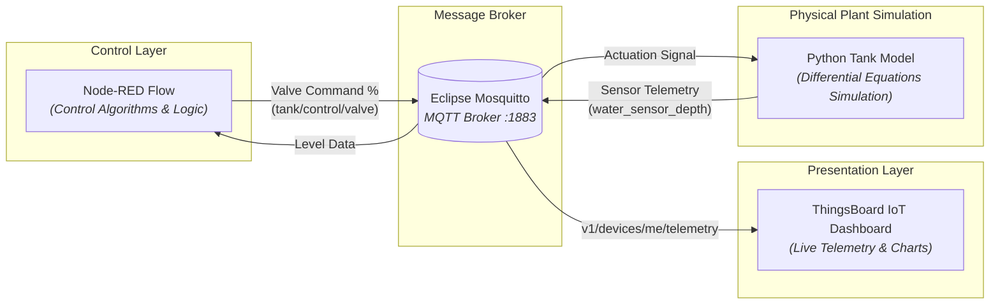

<div align="center">

# Feedback Control System (CN360)

**A Comprehensive IoT-Driven Water Tank Liquid Level Simulation & Feedback Control Testbed**

[](https://www.python.org/downloads/)
[](https://mqtt.org/)
[](https://nodered.org/)
[](https://thingsboard.io/)
[](LICENSE)

<p align="center">
  <a href="#overview">Overview</a> •
  <a href="#system-architecture">Architecture</a> •
  <a href="#lab-modules--control-strategies">Lab Modules</a> •
  <a href="#quick-start">Quick Start</a> •
  <a href="#mqtt-telemetry--topics">MQTT Topics</a> •
  <a href="#project-structure">Project Structure</a>
</p>

</div>

---

## Overview

คลังโค้ดนี้จัดทำขึ้นเพื่อใช้ในการเรียนการสอนและทดลองปฏิบัติการในรายวิชา **CN360 (Feedback Control System)** โดยจำลองพลศาสตร์ระบบระดับของเหลวในถังน้ำ (Water Tank Physical Dynamics Simulation) และเชื่อมโยงวงรอบการควบคุมแบบปิด (Closed-Loop Control) ผ่านเครือข่ายอุตสาหกรรม IoT ด้วยโปรโตคอล **MQTT**, ลอจิกคอนโทรลเลอร์บน **Node-RED** และหน้าจอแดชบอร์ดติดตามผลแบบเรียลไทม์บน **ThingsBoard**

### Key Highlights
- **Realistic Physical Modeling**: จำลองพลศาสตร์ของระดับน้ำตามสมการอนุพันธ์แบบเรียลไทม์ พร้อมการไหลเข้า-ออก และ Leakage
- **Full-Spectrum Control Strategies**: ครอบคลุมตั้งแต่วิธีพื้นฐาน (Open-Loop, ON/OFF with Hysteresis) ไปจนถึง Continuous Control (P, PI)
- **End-to-End IoT Integration**: สื่อสารข้อมูล Telemetry และรับสัญญาณ Actuator Control Signal ผ่าน MQTT Broker มาตรฐานอุตสาหกรรม
- **Modular & Ready to Run**: แยกโครงสร้างแต่ละการทดลองอิสระ สามารถรันเดี่ยวผ่าน Python CLI หรือต่อร่วมกับ Node-RED/ThingsBoard ได้ทันที

---

## System Architecture

ระบบแบ่งการทำงานออกเป็น 4 ส่วนหลัก โดยแลกเปลี่ยนข้อมูลผ่าน MQTT Broker แบบ Asynchronous:



### รายละเอียดส่วนประกอบหลัก
| ส่วนประกอบ | บทบาทและหน้าที่ในระบบ | พอร์ต/การเชื่อมต่อ |
| :--- | :--- | :--- |
| **Python Simulation Engine** | ประมวลผลสมการพลศาสตร์ของถังน้ำ $\frac{dh}{dt} \cdot A = c \cdot u - \text{outflow}$ และส่งค่าเซนเซอร์จำลอง | Python CLI |
| **MQTT Broker (Mosquitto)** | ตัวกลางรับ-ส่งข้อความ Telemetry และ Control Signal ระหว่างโหนดต่างๆ | Port `1883` |
| **Node-RED Engine** | ประมวลผลลอจิกคอนโทรลเลอร์ (Controller Logic) ตามสไลด์การเรียนการสอน | Web UI: `http://localhost:1880` |
| **ThingsBoard Platform** | แดชบอร์ดแสดงผลระดับน้ำต่อเนื่อง (Gauge/Chart) และสถานะ Digital Limit Switch | Web UI: `http://localhost:8080` |

---

## Lab Modules & Control Strategies

```text
┌────────────────────────────────────────────────────────────────────────┐
│                        Feedback Control Labs                           │
├───────────────────┬───────────────────┬────────────────────────────────┤
│ 01. Open Loop     │ 02. ON/OFF        │ 03. P Control   04. PI Control │
│ Timer-based       │ Hysteresis +-10%  │ Error-based     Eliminates SSE │
└───────────────────┴───────────────────┴────────────────────────────────┘
```

### 1. Lab 1: Open Loop Control (Timer-based)
- **หลักการ**: สั่งเปิดวาล์ว 100% ตามเวลา $T$ ที่คำนวณล่วงหน้าโดยไม่อาศัยค่าป้อนกลับจากเซนเซอร์
- **สูตรคำนวณ**:
  $$T = \frac{\text{Target Level} - \text{Initial Level}}{\text{Fill Rate}}$$
- **ข้อจำกัด**: ไวต่อสิ่งรบกวน (Disturbance) และไม่สามารถชดเชยการรั่วไหล/น้ำไหลออกได้

```bash
python lab1_open_loop/open_loop_controller.py
```

---

### 2. Lab 2: ON/OFF Control with Hysteresis (Threshold)
- **หลักการ**: ควบคุมแบบตัด-ต่อโดยใส่ Bandwidth เพื่อป้องกันปัญหาหน้าสัมผัสตัดต่อถี่เกินไป (**Chattering**)
- **เกณฑ์การทำงาน**:
  - $\text{Upper Threshold} = \text{Target} \times 1.10 \implies$ สั่งปิดวาล์ว ($u = 0\%$)
  - $\text{Lower Threshold} = \text{Target} \times 0.90 \implies$ สั่งเปิดวาล์ว ($u = 100\%$)

```bash
python lab2_on_off/on_off_controller.py
```

---

### 3. Lab 3: Proportional (P) Controller
- **หลักการ**: ปรับเปอร์เซ็นต์การเปิดวาล์วแปรผันตรงกับค่าความคลาดเคลื่อน (Error)
  $$e(t) = \text{SP} - \text{PV}$$
  $$u(t) = K_p \cdot e(t)$$
- **ข้อสังเกต**: ตอบสนองเร็วกว่า แต่จะเกิด **Steady-State Error (SSE)** หลงเหลืออยู่เสมอเมื่อมี Outflow

```bash
python lab3_p_control/p_controller.py
```

---

### 4. Lab 4: Proportional-Integral (PI) Controller
- **หลักการ**: เสริมพจน์ Integral ($K_i$) เพื่อสะสม Error สะสมตามเวลา ทำให้สามารถกำจัด Steady-State Error ได้สมบูรณ์
  $$u(t) = K_p \cdot e(t) + K_i \int_{0}^{t} e(\tau) \, d\tau$$
- **ข้อสังเกต**: รักษาค่าระดับน้ำที่ Steady-State ได้ตรงตาม Setpoint แม้มี Outflow ตลอดเวลา

```bash
python lab4_pi_control/pi_controller.py
```

---

## Quick Start

### 1. การเตรียมสภาพแวดล้อม (Prerequisites)
- ติดตั้ง **Python 3.8+**
- ติดตั้งและเปิดบริการ **Eclipse Mosquitto MQTT Broker**
- ติดตั้ง **Node-RED** (`npm install -g --unsafe-perm node-red`)

### 2. ติดตั้ง Dependencies
```bash
git clone https://github.com/Jupiter4428/Feedback-Control.git
cd Feedback-Control
pip install -r requirements.txt
```

### 3. รันระบบการทดลอง
#### ตัวเลือกที่ A: ทดสอบอัลกอริทึมบน Python Standalone
เลือกทดสอบโมดูลการทดลองที่ต้องการได้โดยตรง เช่น:
```bash
python lab3_p_control/p_controller.py
```

#### ตัวเลือกที่ B: ทดสอบระบบเต็มรูปแบบ (Full IoT Integration)
1. **เริ่มระบบจำลองถังน้ำและ MQTT Service**:
   ```bash
   python mqtt_thingsboard/tank_mqtt_service.py
   ```
2. **ตั้งค่าคอนโทรลเลอร์บน Node-RED**:
   - เข้าเว็บเบราว์เซอร์ไปที่ `http://localhost:1880`
   - เมนูมุมขวาบน $\rightarrow$ **Import** $\rightarrow$ เลือกไฟล์ [nodered/flows.json](file:///nodered/flows.json)
   - กดปุ่ม **Deploy**
3. **ตรวจสอบแดชบอร์ด ThingsBoard**:
   - เชื่อมต่ออุปกรณ์ด้วย Access Token ตามการตั้งค่าใน `mqtt_thingsboard/tank_mqtt_service.py`
   - ตรวจสอบค่า Telemetry บน Dashboard แบบเรียลไทม์

---

## MQTT Telemetry & Topics

| Topic | ทิศทางข้อมูล | Payload / Data Format | คำอธิบาย |
| :--- | :---: | :--- | :--- |
| `tank/sensor/depth` | Plant $\to$ Broker | `{"depth": float}` หรือตัวเลขดิบ | ระดับน้ำปัจจุบัน (cm) |
| `tank/control/valve` | Controller $\to$ Plant | `{"valve": float}` (0.0 - 100.0) | สัญญาณสั่งเปอร์เซ็นต์การเปิดวาล์ว |
| `v1/devices/me/telemetry` | Plant $\to$ ThingsBoard | `{"water_sensor_depth": float, "water_sensor_limit_switch": bool}` | ข้อมูล Telemetry ส่งเข้า ThingsBoard IoT Platform |

---

## Project Structure

```text
Feedback-Control/
├── models/
│   ├── __init__.py
│   └── tank_model.py              # โมเดลคณิตศาสตร์จำลองพลศาสตร์ของถังน้ำ (Physical Model)
├── lab1_open_loop/
│   └── open_loop_controller.py    # Lab 1: ควบคุมแบบ Open Loop ด้วยการจับเวลา (Timer-based)
├── lab2_on_off/
│   └── on_off_controller.py       # Lab 2: ควบคุมแบบ ON/OFF พร้อม Hysteresis Band (+-10%)
├── lab3_p_control/
│   └── p_controller.py            # Lab 3: ควบคุมแบบสัดส่วน Proportional (P Controller)
├── lab4_pi_control/
│   └── pi_controller.py           # Lab 4: ควบคุมแบบ Proportional-Integral (PI Controller)
├── mqtt_thingsboard/
│   └── tank_mqtt_service.py       # บริการรันโมเดลและบรอดแคสต์ข้อมูลผ่าน MQTT/ThingsBoard
├── nodered/
│   └── flows.json                 # โฟลว์คอนโทรลเลอร์สำเร็จรูปสำหรับ Import ลง Node-RED
├── requirements.txt               # รายการแพ็กเกจ Python (paho-mqtt ฯลฯ)
└── README.md                      # เอกสารคู่มือโครงการฉบับสมบูรณ์
```

---

## Contributors & Academic Context

โครงงานนี้เป็นส่วนหนึ่งของการปฏิบัติการภาควิชาในหลักสูตรวิศวกรรมศาสตร์:
- **หลักสูตร**: CN360: Feedback Control Systems
- **ผู้พัฒนา**: [Jupiter4428](https://github.com/Jupiter4428)
- **ใบอนุญาตใช้งาน**: เผยแพร่เพื่อประโยชน์ทางการศึกษาภายใต้ [MIT License](LICENSE)
